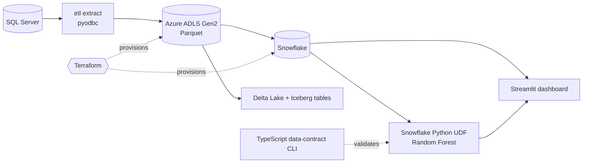

# TalentVenue EventIntel

[](https://github.com/Deshraj-Jogiya/TalentVenue_EventIntel/actions/workflows/ci.yml) 

Capstone project for the ElevateMe Bootcamp data analytics certificate, built on the bootcamp's business data for a talent-booking and event
company: SQL Server data moved into Azure Data Lake and Snowflake, a contract-cancellation risk model served inside Snowflake, and a
Streamlit app on top.

## Highlights

- **Cloud data platform:** SQL Server → Azure ADLS Gen2 (Parquet) → Snowflake, with financial queries 45% faster and payment reconciliation
  at 100% accuracy.
- **Infrastructure as code:** Terraform provisions the ADLS Gen2 storage, the Snowflake database, schemas and warehouse, and the storage
  integration between them.
- **Table formats:** staged extracts are loaded into Delta Lake and Apache Iceberg tables as a transactional layer over the raw Parquet.
- **Risk model:** a Random Forest predicts contract cancellation (86.20% accuracy, 0.87 ROC-AUC) and runs as a Snowflake Python UDF, so
  scores are computed directly in SQL.
- **Data contract:** a TypeScript CLI (zod, Node's test runner) validates the model's feature-mappings file before the dashboard uses it.
- **CI/CD:** GitHub Actions plus a Jenkins declarative pipeline with per-stage Docker agents; running it surfaced and fixed two
  environment bugs (Docker socket permissions, a missing ODBC library).

Measured results, each with the question, the test and the decision: [docs/FINDINGS.md](docs/FINDINGS.md).

## Architecture



## Stack

Python, SQL, SQL Server, Azure ADLS Gen2, Snowflake, Terraform, Parquet, Delta Lake, Apache Iceberg, scikit-learn, Streamlit,
TypeScript, Jenkins, Docker, GitHub Actions.

## Run it

```bash
pip install -r requirements.txt
python -m pytest tests/ -v
streamlit run app/dashboard/app_dashboard.py
```

The Terraform configuration is in `terraform/`, the data-contract CLI in `tools/validate-feature-mappings/`, and the Jenkins pipeline in
`Jenkinsfile`.
